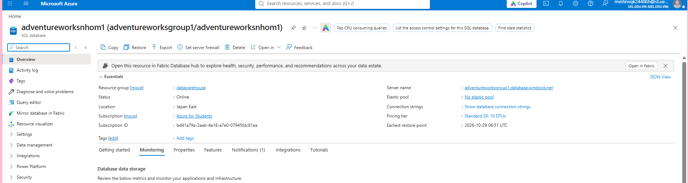
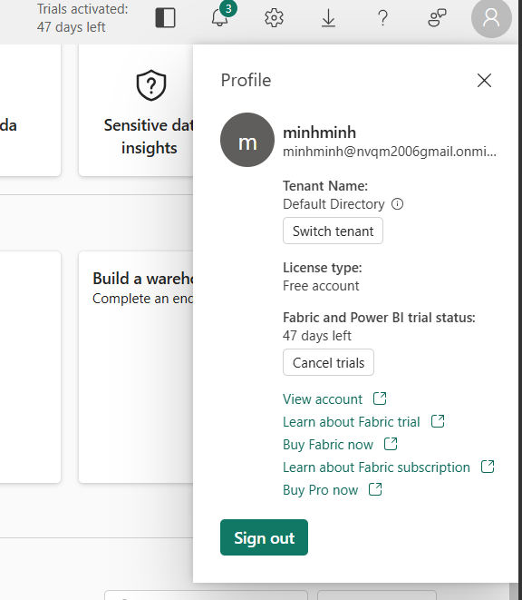

# Bàn giao ngữ cảnh cho phiên agent tiếp theo

Ngày tổng hợp: 05/11/2026. Kế hoạch triển khai: [plan.md](plan.md). Các thông tin Azure/Fabric bên dưới được đọc từ ảnh chụp do người dùng cung cấp; ảnh không ghi thời điểm chụp, nên trạng thái hiện tại phải kiểm tra lại.

## 1. Tutorial, mục lục và yêu cầu

- Chưa có link tutorial **Azure/Fabric** riêng trong repo. Link video đã ghi ở plan là [hướng dẫn cài LaTeX Workshop trên Windows](https://www.youtube.com/watch?v=4lyHIQl4VM8), không phải tutorial Azure/Fabric. Agent tiếp theo có thể tự tra tài liệu/tutorial phù hợp và kiểm tra log, lịch sử hoặc tài nguyên thực tế khi có quyền truy cập; không cần chờ người dùng cung cấp tutorial nếu không có.
- [Mục lục chi tiết](../../docs/source/content/tableofcontent.md) đã có, gồm 7 chương: tổng quan; dữ liệu bán hàng; kho dữ liệu Fabric; học máy; tự động hóa và khai thác; thử nghiệm và đánh giá; kết luận. Các mục triển khai chính: Lakehouse Bronze/Silver/Gold, Data Pipeline, Dataflow Gen2, Fabric Warehouse và star schema, semantic model/Power BI, dự báo doanh số và nhu cầu, web application.
- [Bản nháp chương 1](../../docs/source/content/semidone_c1.md) đã có. **Chưa thấy rubric/thang điểm riêng** trong repo. Mục lục là đề cương hiện có, chưa thể coi là rubric chính thức.

## 2. Azure SQL Database và dữ liệu

| Thuộc tính | Giá trị đọc từ ảnh |
|---|---|
| Loại tài nguyên | Azure SQL Database |
| Database | `adventureworksnhom1` |
| SQL server | `adventureworksgroup1.database.windows.net` |
| Server/resource trên tiêu đề | `adventureworksgroup1/adventureworksnhom1` |
| Resource group | `datawarehouse` |
| Subscription | Azure for Students |
| Vùng | Japan East |
| Trạng thái lúc chụp | Online |
| Pricing tier lúc chụp | Standard S0, 10 DTUs; không có elastic pool |

- Trong repo có [dữ liệu AdventureWorks dạng CSV và SQL nguồn](../../AdventureWorks/raw/), gồm các bảng liên quan bán hàng như `SalesOrderHeader`, `SalesOrderDetail`, `Customer`, `Product`, `ProductCategory`, `SalesTerritory`. **Có file cục bộ không chứng minh dữ liệu đã được nạp lên Azure SQL hoặc Fabric**; danh sách bảng, số dòng và lần nạp trên cloud vẫn chưa được xác minh.
- Mục tiêu phân tích theo [mục lục](../../docs/source/content/tableofcontent.md) và [chương 1](../../docs/source/content/semidone_c1.md): doanh thu, số lượng bán và số đơn hàng theo thời gian, sản phẩm, khách hàng, khu vực và kênh bán; dashboard Power BI và dự báo doanh số. Mục lục còn nêu dự báo nhu cầu/nguy cơ hết hàng. Đây là mục tiêu đồ án, chưa phải kết quả đã triển khai.
- Không ghi mật khẩu, connection string có secret hoặc token trong artifact.

## 3. Fabric workspace, trial và quyền

- Ảnh profile cho thấy tài khoản `minhminh`, license **Free account**, Fabric and Power BI trial còn **47 ngày tại thời điểm chụp**. Không suy ra ngày hết trial hay capacity hiện tại từ ảnh này.
- Văn bản người dùng cung cấp từ **Workspace identities**: identity ID `deab57d4-a0bf-45f4-b93f-db8c17b3d1f8`, app ID `327989a3-e85b-4e98-a890-5e958c27f902`, state `Active`; người dùng `minhminh` có quyền `Can edit members` trong phần **Authorized users** của identity. Đây là quyền trên workspace identity, **chưa xác nhận role của tài khoản trong workspace** hoặc quyền trên Azure SQL Database.
- **Đã có** URL workspace `https://app.fabric.microsoft.com/groups/d0eaee60-9f3e-47b2-8aee-bbd327ab2062/list?experience=fabric-developer`, do người dùng cung cấp sau bản tổng hợp đầu tiên. **Chưa có** tên workspace, capacity ID/SKU, danh sách item hoặc bằng chứng phiên đăng nhập có thể dùng bằng công cụ. Edge của người dùng đã mở, nhưng không bật cổng điều khiển; lệnh mở Edge riêng với remote debugging bị hệ thống phê duyệt tự động chặn với thông báo “blocked by policy”. Thử Microsoft Azure PowerShell device login bị Entra từ chối mã [530035](https://login.microsoftonline.com/error?code=530035), tức security defaults chặn ứng dụng này. Đã dừng phiên đăng nhập; không thử cách khác để vượt chính sách. Cần quản trị viên xác định đường API được phép, hoặc người dùng chạy truy vấn kiểm kê read-only trong UI rồi cung cấp kết quả. Không lưu credential vào Git.

## 4. Tiến độ và việc cần tiếp tục

**Đã có bằng chứng:** CSV/SQL nguồn trong repo; mục lục và nháp chương 1; khung LaTeX tại [docs/main.tex](../../docs/main.tex) và PDF build tại `docs/build/main.pdf`; hai ảnh chụp Azure SQL Database và Fabric profile; thông tin workspace identity do người dùng dán. DOCX Gold đã được tách thành SQL A–J và hai notebook tại [`fabric/`](../../fabric/README.md); đây là artefact cục bộ, chưa phải bằng chứng chạy thành công trên Fabric.

**Chưa được chứng minh hoàn thành:** kiểm kê bảng và dữ liệu đã nạp trên Azure SQL; workspace/capacity/role Fabric; pipeline, Lakehouse, Warehouse, semantic model, dashboard, mô hình học máy, web app, các run/log và đối chiếu số liệu. Plan hiện là khảo sát, chưa có bằng chứng triển khai cloud trong repo.

**Tiếp tục theo [plan.md](plan.md):** (1) kiểm kê tài nguyên và dữ liệu thực tế; (2) ánh xạ mục lục với kiến trúc, tài nguyên và bằng chứng; (3) triển khai luồng nạp/mô hình có thể chạy lại; (4) kiểm tra dữ liệu và kết quả phân tích; (5) thu ảnh/log; (6) hoàn thiện và build báo cáo LaTeX. Đối chiếu mọi nhận định trong báo cáo với kết quả thực tế.

**Giới hạn chi phí và thời gian chạy:** người dùng chưa nêu mức trần. Azure for Students và trial trong ảnh không thay thế cho xác nhận hạn mức hiện tại. Trước khi chạy pipeline lớn hoặc tạo tài nguyên tính phí, kiểm tra subscription credit, capacity/trial và chi phí ước tính; bắt đầu bằng thao tác read-only và thử nghiệm nhỏ.
